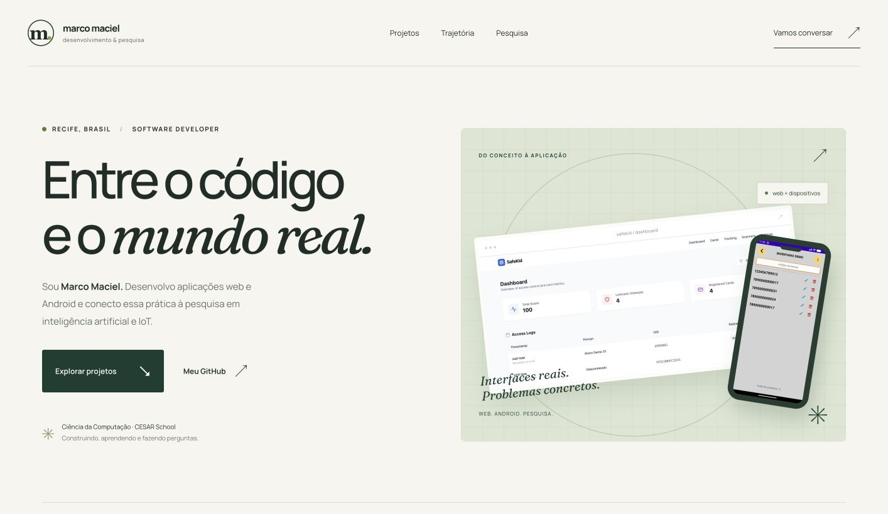

# Marco Maciel — Portfólio

**[Abrir o portfólio](https://marco-maciel-portfolio.fit-spark-7889.chatgpt.site/)**



Portfólio pessoal de desenvolvimento web, Android e pesquisa aplicada. Design editorial responsivo, com imagens reais dos projetos em ambientes de demonstração.

## Executar localmente

Não exige instalação de pacotes nem build. Com Python 3:

```sh
python3 -m http.server 4173 --directory dist --bind 127.0.0.1
```

Abra http://127.0.0.1:4173. O site está em `dist/` e pode ser servido por qualquer hospedagem estática.

## Publicação

O site está publicado no Sites. Este repositório reúne seu código estático para desenvolvimento e versionamento. Não há dependências de runtime ou etapa de build.

## Estrutura

- `dist/index.html`: conteúdo e estrutura semântica.
- `dist/styles.css`: identidade visual, responsividade e estados de interação.
- `dist/app.js`: apresentações dos projetos, menu mobile e cópia de e-mail.
- `dist/i18n.js`: traduções PT/EN da página, dos projetos e dos rótulos acessíveis.
- `dist/assets/`: capturas de demonstração, fontes locais e favicon.

Os links e textos dos projetos em detalhe ficam em `projectData`, no início de `app.js`. Experiências, pesquisa e contato também aparecem em `index.html`; mantenha ambos atualizados ao mudar informações compartilhadas. Datas de apresentações futuras devem ser revisadas após os eventos.

## Projetos em destaque

- [MGM Ambiental](https://github.com/oMarcoMaciel/MgmAmbiental-Portfolio)
- [Seaway](https://github.com/oMarcoMaciel/Leitor-SeaWay-Portfolio)
- [SafeKid](https://github.com/oMarcoMaciel/SafeKid-Portfolio)

As imagens não contêm dados de clientes ou estudantes reais. O código e as bases dos aplicativos profissionais não fazem parte deste projeto.

## Recursos visuais

Fontes locais: Manrope e Fraunces (itálica), distribuídas sob a SIL Open Font License. Arquivos de licença em `dist/assets/`. As capturas foram produzidas a partir dos projetos do autor; a interface dos aplicativos não foi redesenhada nas imagens.

## Idiomas

O seletor PT/EN no cabeçalho traduz o conteúdo e os detalhes dos projetos. A preferência fica salva no navegador quando o armazenamento está disponível. Links com `?lang=en` ou `?lang=pt` abrem o idioma explicitamente e têm prioridade sobre a preferência salva. As capturas dos aplicativos mantêm a interface original.
